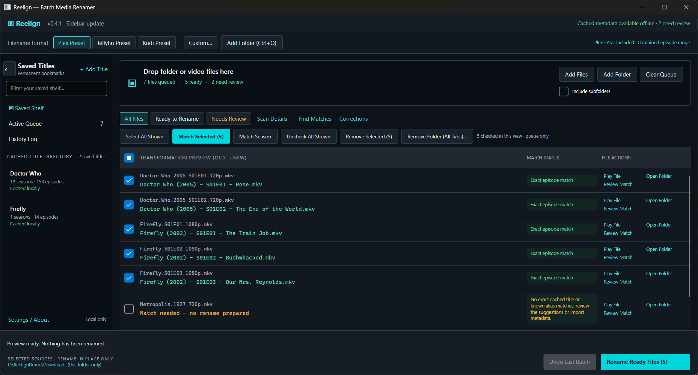
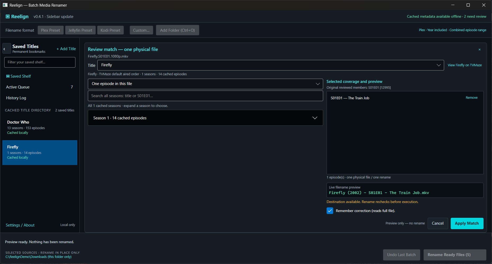
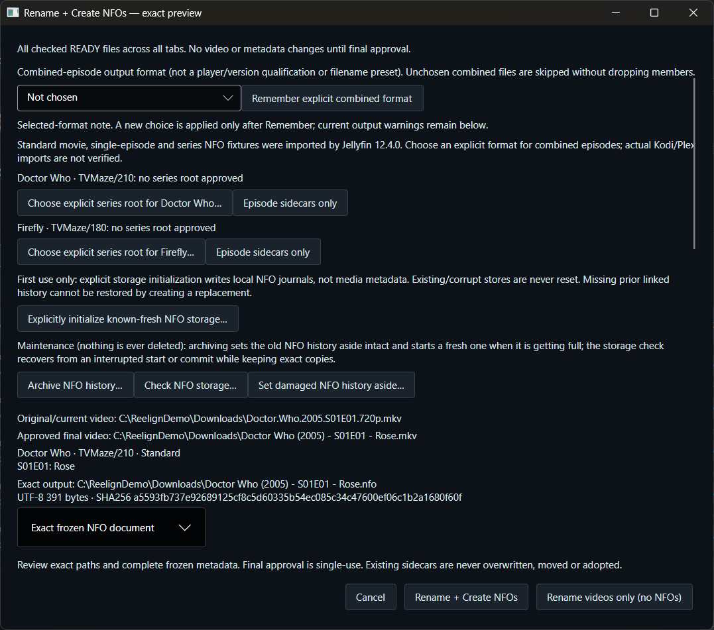
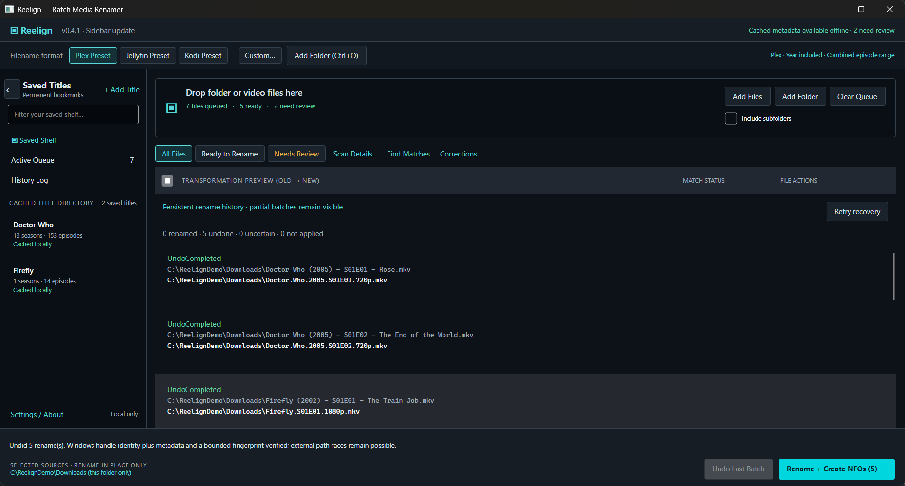

# Reelign

**A free Windows media renamer that shows you exactly what will change before it touches a file.**

Reelign identifies TV episodes and movies, previews clean filenames, and renames your existing videos in place. Every batch is recorded, and Undo restores the original names.

> **Status: public beta.** Reelign is free and the Windows x64 beta is available as a portable ZIP on the [Releases page](https://github.com/Neon-Nomad/reelign-releases/releases/tag/beta-2) (unzip and run `Reelign.Desktop.exe`; no installer). The build is **not code-signed**, so Windows SmartScreen may warn: choose More info, then Run anyway, and compare the ZIP's SHA-256 with the checksum on the release page. Try it on copies of your media first. Not yet verified on a clean Windows install; Plex/Kodi NFO import and network-share (SMB) use are untested. Source code is not published in this repository. Some TMDB/TVmaze licensing and caching questions are still open; see the [notices](https://neon-nomad.github.io/reelign-releases/legal.html).

## See it working

These are screenshots of the real running Windows app, captured against disposable placeholder files.

**Preview before anything changes.** Matched files show the old name and the proposed new name side by side. Nothing is renamed until you approve.

**Review any match.** Pick the episode, see the live filename preview, then apply.

**Optional NFO sidecars, off by default.** If you turn them on, you see the exact paths and the full contents before approving. Existing NFO files are never overwritten. NFO creation is limited to local NTFS drives.

**Undo.** Every batch is recorded in History, and Undo restores the original names.

More: [main window](screenshots/01-main-window.png) · [NFO settings](screenshots/05a-nfo-settings.png) · [completed batch](screenshots/06-batch-completed.png) · [history log](screenshots/07a-history-log.png) · [Saved Titles sidebar](screenshots/08-saved-titles-sidebar.png)

## What it does

- **Preview-first renaming.** Review old and new names, with collision checks, before any file is renamed.
- **TV and movies.** Matches episodes through TVmaze, and movies through TMDB with your own free API token.
- **Combined episodes.** A file holding several episodes stays one file, with all episodes in its name.
- **Naming presets.** Plex, Kodi and Jellyfin styles, or your own custom templates.
- **Undo.** A persistent journal records every rename so a batch can be reversed.
- **Review when unsure.** Ambiguous matches are never guessed. You choose.
- **Optional NFO sidecars.** Off by default, local NTFS drives only.
- **Your data stays local.** Your queue, rename history and settings live on your PC. The only network requests are title lookups to TVmaze and TMDB.

## Compatibility

NFO files written by Reelign have been verified to import correctly in **Jellyfin 12.4.0**. Compatibility with Kodi and Plex has not been verified yet, so it is not claimed here.

## Cost

Reelign is free. There are no paid features.

## Requirements

Windows x64. The app is self-contained, so no separate .NET install is needed.

## Interested in testing?

The public beta is ready to try: [download the ZIP from the Releases page](https://github.com/Neon-Nomad/reelign-releases/releases/tag/beta-2). Please use copies of your media. Found a bug or want a feature? [Open an issue](https://github.com/Neon-Nomad/reelign-releases/issues/new) and say which media server you use and roughly how many files you rename.

## Credits and attribution

Reelign uses TMDB and the TMDB APIs but is not endorsed, certified, or otherwise approved by TMDB.

TV metadata is provided by [TVmaze](https://www.tvmaze.com), used under CC BY-SA 4.0.

Reelign is built with Avalonia, SQLite and other open-source components under their own licences.

## Licence

Copyright (c) Reelign. All rights reserved. The Reelign application and its source are not offered under an open-source licence. Screenshots and text in this repository may not be reused without permission.
